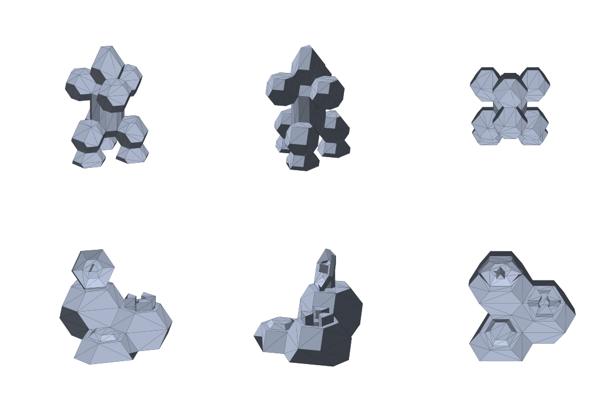

# 3D pawns

*[Wersja polska](README_pl.md)*

General-purpose 3D-printable pawns for any game on this board.

| File | Model | Size |
|------|-------|------|
| [ship.stl](ship.stl) | transport ship – modular hull on a spine, with nozzles at the bottom; indirectly inspired by the Eagle 1 from "Space: 1999" | 26 × 26 × 36 mm |
| [outpost.stl](outpost.stl) | outpost on an asteroid, with a long-range communication antenna | 30 × 30 × 24 mm |

## Size

The board is meant to be printed in A2 format. A hex is then about 30 mm across the flats, and a pawn fits within one hex if it is at most about 27 mm wide.

- **The ship** fits without scaling. It has no base – it is meant to be turned freely in the hand, and a base would hide the nozzles. It also stands well on its side.
- **The outpost** takes up almost the whole hex – it is worth printing at about 0.9 scale.

## Printing

- The ship needs supports under its lower modules (tree supports work best); the outpost prints without supports.
- The ship stands on the print bed on three small nozzles – a brim may help.

## To fix

- The ship file is saved in metres, the outpost in millimetres. Some slicers will load the ship at the wrong scale – it has to be scaled ×1000 or re-exported in millimetres.
- Both models consist of overlapping bodies. Slicers usually cope, but before publishing it is worth merging them (Boolean Union or "Make Manifold" in Blender). The ship also contains a stray double triangle of zero thickness.
- The outpost's antenna has parts 0.1–0.5 mm thick – to be thickened to at least about 1 mm at the final scale.
