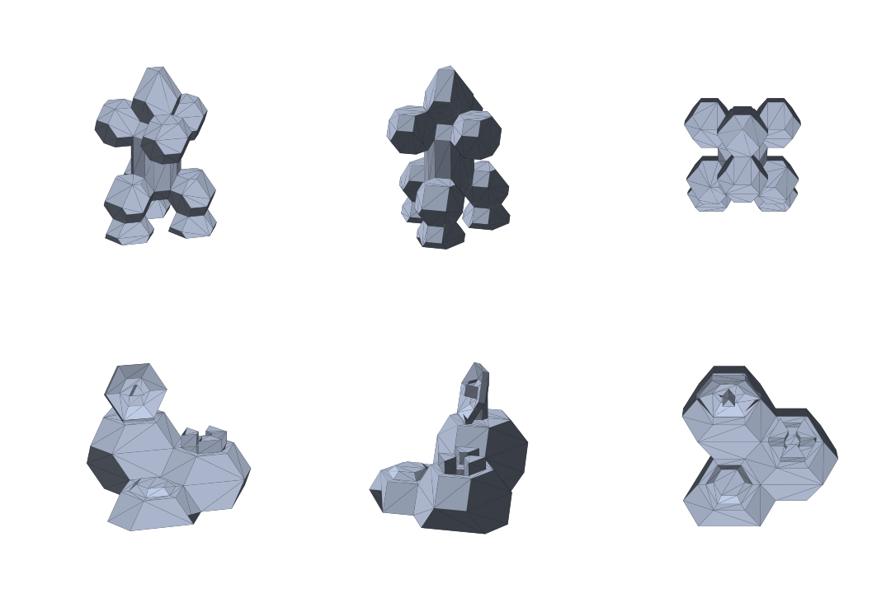

# Pionki 3D

*[English version](README.md)*

Uniwersalne pionki do druku 3D, do wykorzystania w dowolnej grze na tej planszy.

| Plik | Model | Wymiary |
|------|-------|---------|
| [ship.stl](ship.stl) | statek transportowy – modułowy kadłub na kręgosłupie, z dyszami na dole; inspirowany pośrednio statkiem Eagle 1 z serialu „Kosmos 1999” | 26 × 26 × 36 mm |
| [outpost.stl](outpost.stl) | placówka na planetoidzie, z anteną do dalekiej komunikacji | 30 × 30 × 24 mm |

## Statek – intencje projektowe

Od dołu do góry:

- **Zbiorniki i dysze.** Na dole są zbiorniki na „paliwo” – właściwie materiał pędny, odrzucany przez silnik – i dysze silników fuzyjnych.
- **Ładownia.** Podłużny kadłub to ładownia.
- **Habitat.** Trzy moduły wyżej służą do przewozu ludzi i innych istot żywych. Trzy niezależne moduły dają redundancję dla bezpieczeństwa. Obrót statku wokół jego osi wytwarza w nich pozorną grawitację.
- **Mostek.** Na dziobie jest mostek (sterownia).

Ścięty kształt dziobu i zbiorników przy dyszach nie służy opływowości – w próżni nie ma ona znaczenia – tylko widoczności z mostka: wizualnej oraz dla anten i czujników.

**Skala statku.** Obrót wokół osi, wzdłuż której działa ciąg, nie przeszkadza w locie. Pozorna grawitacja wymaga jednak dużego promienia, bo przy szybszym obrocie ludzie dostają choroby lokomocyjnej – bezpieczna granica to zwykle ok. 2–4 obrotów na minutę:

| Pozorna grawitacja | przy 4 obr./min | przy 2 obr./min |
|--------------------|-----------------|-----------------|
| 0,3 g | ok. 17 m od osi | ok. 67 m od osi |
| 1 g | ok. 56 m od osi | ok. 220 m od osi |

Na modelu moduły habitatu leżą od osi w odległości ok. 1/4 długości statku. Prawdziwy statek miałby więc od ok. 70 m długości (0,3 g przy szybkim obrocie) do blisko kilometra (1 g przy wolnym). „Podłoga” w habitacie jest po stronie odwróconej od osi statku.

## Rozmiar

Plansza jest przeznaczona do druku w formacie A2. Pole ma wtedy ok. 30 mm między bokami, a pionek mieści się w jednym polu przy szerokości do ok. 27 mm.

- **Statek** mieści się bez skalowania. Nie ma podstawki – ma się dać swobodnie obracać w palcach, a podstawka zasłaniałaby dysze. Dobrze stoi również na boku.
- **Placówka** zajmuje prawie całe pole – warto ją drukować w skali ok. 0,9.

## Druk

- Statek potrzebuje podpór pod dolnymi modułami (najlepiej drzewiastych); placówka drukuje się bez podpór.
- Statek stoi na stole drukarki na trzech małych dyszach – pomóc może brim.

## Do poprawy

- Plik statku jest zapisany w metrach, placówki w milimetrach. Część slicerów wczyta statek w złej skali – trzeba go przeskalować ×1000 albo wyeksportować ponownie w milimetrach.
- Oba modele składają się z nachodzących na siebie brył. Slicery zwykle sobie z tym radzą, ale przed publikacją warto je połączyć (Boolean Union albo „Make Manifold” w Blenderze). W statku jest też zabłąkany podwójny trójkąt o zerowej grubości.
- Antena placówki ma miejsca grube na 0,1–0,5 mm – do pogrubienia do min. ok. 1 mm w docelowej skali.
